# Handbuch zum Produkt

CT E-Rechnungsimporter - für Anwender und kundenseitige Administratoren

Dokumentstand: 26. November 2026, RC05-Vorbereitung. Programmstand:
`5ad0a2c01490eaaafc65e4229298d8e074710bef`, Datenbankschema 008.

Dieses Handbuch beschreibt die gelieferte Oberfläche für die Rollen Lesen und
Verwaltung. Die Abbildungen zeigen diese Oberfläche mit ausschließlich synthetischen
Beispieldaten. Namen, Zahlen, Termine und der beispielhafte Eingang am 01.12.2026
sind keine Kundenbelege und keine aktuelle Betriebsanzeige. Die Bildschirmdarstellung
kann je nach Fenstergröße und Browser leicht abweichen.

Der reguläre Import berücksichtigt gelesene und ungelesene Mails ab
23.11.2026, 00:00 Uhr Europe/Berlin. Die Beispieltermine der Bilder ändern
diesen tatsächlichen Eingangsstichtag nicht. Die abschließende Release- und
Kundenabnahme ist noch offen.

<!-- toc:start -->
## Inhaltsverzeichnis

1. [Schnell zum passenden Ablauf](#1-schnell-zum-passenden-ablauf)
2. [Anmelden und abmelden](#2-anmelden-und-abmelden)
3. [Übersicht und Betriebsstatus](#3-übersicht-und-betriebsstatus)
4. [Vorgänge suchen und filtern](#4-vorgänge-suchen-und-filtern)
5. [Details und Ergebnisse verstehen](#5-details-und-ergebnisse-verstehen)
6. [Kategorien, Mailziele und Fahne](#6-kategorien-mailziele-und-fahne)
7. [Unbekannte Anhänge prüfen](#7-unbekannte-anhänge-prüfen)
8. [Original und PDF-Vorschau öffnen](#8-original-und-pdf-vorschau-öffnen)
9. [Eine Zuordnung freigeben](#9-eine-zuordnung-freigeben)
10. [Technische Wiederholung und unklare Antworten](#10-technische-wiederholung-und-unklare-antworten)
11. [Dubletten richtig einordnen](#11-dubletten-richtig-einordnen)
12. [Ältere Vorgänge im Archiv lesen](#12-ältere-vorgänge-im-archiv-lesen)
13. [Administration und Verarbeitungseinstellungen](#13-administration-und-verarbeitungseinstellungen)
14. [Berichte anzeigen](#14-berichte-anzeigen)
15. [Berichtszahlen richtig lesen](#15-berichtszahlen-richtig-lesen)
16. [Empfänger und Benachrichtigungspläne](#16-empfänger-und-benachrichtigungspläne)
17. [Testmail und Versandverlauf](#17-testmail-und-versandverlauf)
18. [Graph-Zertifikat und Warnungen](#18-graph-zertifikat-und-warnungen)
19. [Erneuerung erlauben und verfolgen](#19-erneuerung-erlauben-und-verfolgen)
20. [Verbindungen und Änderungsprotokoll](#20-verbindungen-und-änderungsprotokoll)
21. [Alltagssituationen entscheiden](#21-alltagssituationen-entscheiden)
22. [Häufige Fragen](#22-häufige-fragen)
23. [Begriffe nachschlagen](#23-begriffe-nachschlagen)
24. [Betreuung, Grenzen und weitere Unterlagen](#24-betreuung-grenzen-und-weitere-unterlagen)
<!-- toc:end -->

## 1. Schnell zum passenden Ablauf

Der Importer holt geeignete Anhänge aus einem vereinbarten Microsoft-365-Postfach,
erkennt ihre Dokumentart und legt relevante Originale passend ab. Das Portal zeigt
die tatsächlich protokollierten Vorgänge und ihre Ergebnisse. Sie müssen erkannte
Rechnungen nicht einzeln bestätigen. Ihre fachliche Prüfung ist bei offenen
unbekannten Anhängen erforderlich.

**Eingangsstichtag:** Berücksichtigt werden ausschließlich Mails ab 23. November 2026,
00:00 Uhr Europe/Berlin. Ältere Mails bleiben unangetastet. Vor diesem Stichtag ist
ein leeres Journal möglich, obwohl die Zeitpläne aktiv sind.

| Ihr Anliegen | Einstieg |
| --- | --- |
| Funktioniert der geplante Betrieb? | Übersicht, Bereich Betriebsstatus; Kapitel 3. |
| Eine bestimmte Datei oder einen Fehler finden | Vorgänge, Suche und Filter; Kapitel 4 und 5. |
| Dokumentart klären | Unbekannt, dann Original und Zuordnung; Kapitel 7 bis 9. |
| Ein Vorgang bleibt fehlerhaft oder eine Antwort unklar | Kapitel 10 und 21; bei unklarer Wirkung Betreuung hinzuziehen. |
| Zahlen für einen Tag oder eine Woche ansehen | Administration > Berichte; Kapitel 14 und 15. |
| Meldungen oder Graph-Zertifikat verwalten | Kapitel 16 bis 20, nur mit Verwaltungsrecht. |

Die Oberfläche zeigt oben rechts Ihre Rolle. Die Zuordnung erfolgt über die
vorhandenen Firmenkonten und Gruppen:

| Rolle | Was Sie tun können |
| --- | --- |
| Lesen, Gruppe GR_CEO | Vorgänge, verfügbare Originale, Archiv, Berichte, Einstellungen und Verläufe lesen. Keine fachlichen Freigaben, Testaufträge oder Änderungen. |
| Verwaltung, Gruppe GR_Rechnung | Zusätzlich zulässige Zuordnungen und technische Wiederholungen freigeben, Einstellungen ändern, feste Testmail auslösen und Graph-Erneuerung erlauben/anfordern. |

Die Berechtigung wird auch auf dem Server geprüft. Eine sichtbare Seite bedeutet
deshalb nicht, dass jede Aktion erlaubt ist. Eine fehlende oder gesperrte Aktion
nicht durch ein anderes Fenster oder ein fremdes Konto umgehen.

## 2. Anmelden und abmelden

Öffnen Sie die von Ihrer Betreuung mitgeteilte Portaladresse im vorgesehenen
Kundennetz beziehungsweise über den vereinbarten VPN-Zugang. Verwenden Sie einen
aktuellen Browser und eine gültige HTTPS-Verbindung. Die öffentliche Anleitung
enthält bewusst keine tatsächlichen Zugangsdaten oder Portaladresse.

1. Tragen Sie unter **Benutzername oder UPN** Ihr bestehendes Windows-Konto in der
   vereinbarten Schreibweise ein. Ein UPN sieht beispielsweise wie eine Firmenmailadresse aus.
2. Geben Sie Ihr Firmenkennwort unter **Kennwort** ein und wählen Sie **Anmelden**.
3. Prüfen Sie oben rechts den angezeigten Kontonamen und die Rolle Lesen oder Verwaltung.
4. Beenden Sie Ihre Portalsitzung über **Abmelden**, besonders an gemeinsam verwendeten Geräten.

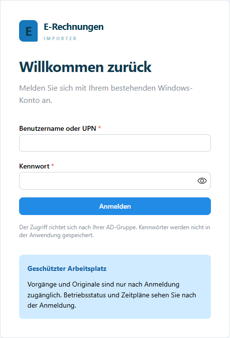

Das Portal besitzt keine eigene Kennwortverwaltung. Kennwort- oder Gruppenfragen
klärt Ihre zuständige IT. Bei nicht geladener Verbindung erscheint **Verbindung
erneut prüfen**. Nach einer abgelaufenen Sitzung melden Sie sich erneut an.
Die Sitzung endet spätestens nach acht Stunden und nach 30 Minuten ohne Aktivität.
Auch gesperrte Konten oder entzogene Gruppenrechte können den Zugriff beenden.

Wiederholtes Probieren mit einem unsicheren Kennwort kann eine Anmeldebegrenzung
auslösen. Bei anhaltender Störung die genaue Meldung und Uhrzeit an die Betreuung
geben, niemals das Kennwort. Nach einer erfolgreich aktivierten Verbindungskonfiguration
ist eine neue Anmeldung vorgesehen; das ist kein verlorener Verarbeitungsvorgang.

## 3. Übersicht und Betriebsstatus

Links stehen **Übersicht**, **Vorgänge**, **Unbekannt**, **Archiv** und **Administration**.
Auf kleinen Bildschirmen öffnen drei Striche die Navigation. Oben rechts: Konto,
Rolle, Abmelden. **Aktualisieren** lädt Arbeitslisten und Betriebsstatus neu und
startet keinen Import.

Die Übersicht bietet vier Kacheln: Vorgänge, Unbekannt, Dubletten und Fehler.
**Ansehen** öffnet die passende Liste; bei Dubletten beziehungsweise Fehlern wird
der entsprechende Filter gesetzt. Unbekannt zählt offene Anhänge, nicht ganze Mails.
Darunter erscheinen die letzten fünf Vorgänge; **Alle ansehen** öffnet die vollständige Liste.

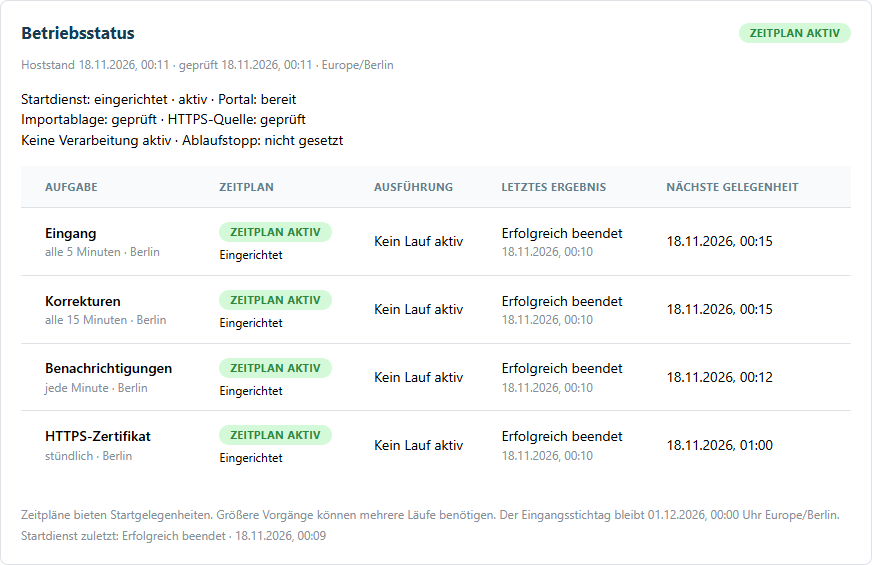

| Anzeige | Bedeutung und Reaktion |
| --- | --- |
| Zeitplan aktiv, grün | Der frische Betriebsnachweis bestätigt den vorgesehenen Ablauf. Das ist kein Beleg für eine bereits verarbeitete bestimmte Mail. |
| Zeitplan pausiert, grau | Für den betreffenden Ablauf ist keine aktive Zeitplanung bestätigt. Bei unerwarteter Pause Betreuung fragen. |
| Aktiv mit Einschränkungen, gelb | Zeitplanung vorhanden, aber eine Voraussetzung oder ein Ergebnis ist eingeschränkt. Details lesen und gegebenenfalls melden. |
| Nicht prüfbar, grau | Kein ausreichend frischer, passender Nachweis. Aktualisieren; bleibt der Zustand bestehen, Betreuung informieren. |

**Kein Lauf aktiv** ist zwischen Läufen normal, **Zurückgestellt** erklärt eine
vorgemerkte Aufgabe oder Sperre. Nächste Gelegenheit ist keine Fertigstellungszusage; größere Vorgänge
brauchen mehrere Läufe. Zeitplan, aktuelle Ausführung und letztes Ergebnis sind
getrennte Angaben.

## 4. Vorgänge suchen und filtern

Öffnen Sie **Vorgänge**. Jede Zeile gehört zu einem protokollierten Mailvorgang.
Sie sehen Eingang und kurze Vorgangskennung, Anhangsnamen und -anzahl, offene
unbekannte Anhänge, Dubletten, Kategorien und den aktuellen Status.

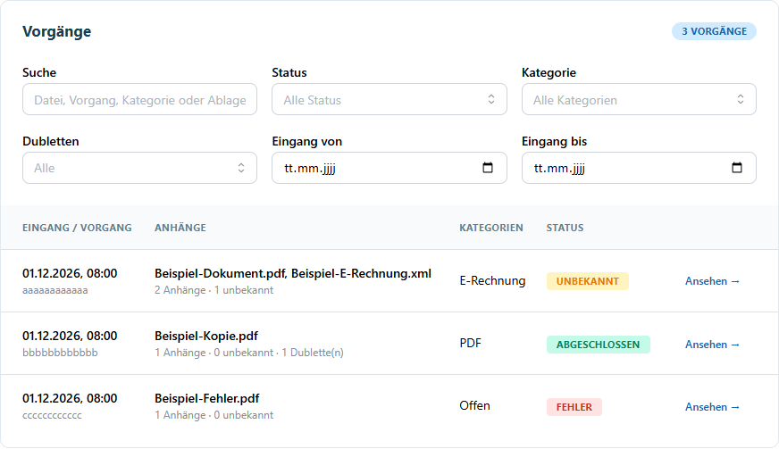

1. Geben Sie unter **Suche** einen Teil des Dateinamens, der Vorgangskennung,
   einer Kategorie oder eines Ablageziels ein.
2. Grenzen Sie bei Bedarf mit **Status**, **Kategorie** und **Dubletten** ein.
   Die Auswahl Fehler / Klärung erforderlich fasst die entsprechenden Problemfälle zusammen.
3. Verwenden Sie **Eingang von** und **Eingang bis**, um nach dem Mail-Eingangsdatum
   einzugrenzen. Das ist etwas anderes als die erste Protokollanlage im Bericht.
4. Öffnen Sie den passenden Vorgang über **Ansehen**. Bei mehr als 25 Treffern
   wechseln Sie mit der Seitenauswahl weiter.

Filter wirken gemeinsam. Eine Kategorieauswahl bedeutet, dass ein passender
Anhang zum Vorgang gehört; andere Anhänge können andere Kategorien oder Probleme
haben. Setzen Sie eine Auswahl mit ihrem Löschsymbol zurück. Ein Wechsel über die
Hauptnavigation setzt die Such- und Filterauswahl zurück.

**Keine Vorgänge für diese Auswahl** bedeutet eine leere Treffermenge. Prüfen Sie
Filter, Datum und gegebenenfalls das Archiv. **Daten konnten nicht geladen werden**
ist ein Ladefehler und keine bestätigte Nullstatistik. Wiederholt sich der Fehler,
Meldung und Auswahl an die Betreuung geben.

## 5. Details und Ergebnisse verstehen

**Ansehen** öffnet den Dialog **Vorgang und Original**. Bei mehreren Anhängen
wählen Sie rechts unter **Anhänge dieses Vorgangs** genau den gewünschten Anhang.
Ein bereits verarbeiteter Anhang kann neben einem unbekannten oder fehlerhaften
Anhang stehen. Aus dem Mailstatus allein lässt sich daher nicht jede Datei beurteilen.

Im Bereich **Befund** stehen die verständliche Erkennungsbewertung, aktuelle
Zuordnung und Ablage. Ein vorhandenes Ablageziel zeigt den protokollierten Pfad.
**Noch kein bestätigter Ablagebeleg** bedeutet, dass hier noch kein passender Erfolg
bestätigt ist. Ein sichtbarer Kategoriename allein beweist keine Ablage.

Bei einem nicht verarbeiteten Anhang erklärt ein zusätzlicher Hinweis, warum
die Erkennung oder Verarbeitung zurückgestellt wurde und welcher nächste Schritt
hilft. Geben Sie der Betreuung den Dateinamen, Zeitpunkt und angezeigten Hinweis
weiter. Ein nicht unterstütztes E-Rechnungsprofil beweist keinen Fehler des
Rechnungsstellers. Diesen erst bei bestätigtem Dateifehler um eine korrigierte
Rechnung bitten. Bei mehreren Anhängen gelten die Hinweise jeweils für die
betroffene Datei; erfolgreich abgelegte Anhänge bleiben erhalten.

| Status | Wie Sie ihn lesen |
| --- | --- |
| Wartet / In Bearbeitung | Der Vorgang ist registriert oder wird bearbeitet. Zunächst den nächsten Lauf abwarten. |
| Abschluss läuft | Erforderliche abschließende Aktionen sind noch nicht vollständig bestätigt. |
| Unbekannt | Mindestens ein relevanter Befund braucht Klärung. Den einzelnen Anhang prüfen. |
| Freigegeben | Eine zulässige Entscheidung ist gespeichert; die Ausführung folgt später. |
| Verarbeitet / Abgelegt | Für den betreffenden Anhang ist der entsprechende Ergebnisbeleg vorhanden. |
| Abgeschlossen | Der Vorgang hat seine erforderlichen Verarbeitungsschritte abgeschlossen. Andere Einzelhinweise weiterhin beachten. |
| Fehler / Klärung erforderlich | Technischer Fehler oder ein Zustand, der eine gezielte Klärung benötigt. Keine beliebigen Wiederholungen. |

Falls eine Freigabe vorliegt, zeigt **Freigabe** Auswahl, Konto, Zeitpunkt und
Stand. **Technische Angaben und Verlauf** lässt sich aufklappen. Dort finden Sie
Vorgangs-/Anhangskennung, Bytegröße, Fingerabdruck, Erstbefund, aktuellen Befund,
Fehlercode, Dateibeleg und Bestätigung des Mailabschlusses. Diese Angaben helfen
der Betreuung; Sie müssen sie im Normalfall nicht selbst technisch interpretieren.

Schließen Sie den Dialog mit dem Kreuz. Während eine Aktion übermittelt wird,
kann das Schließen vorübergehend gesperrt sein. Änderungen und Meldungen erst
abwarten; ein erneuter Klick macht einen Vorgang nicht schneller.

## 6. Kategorien, Mailziele und Fahne

**Ablagekategorie und Mailordner sind unterschiedliche Dinge.** Die Kategorie
bestimmt, wo ein relevanter Anhang abgelegt wird. Für eine Mail mit mehreren
Anhängen entscheidet anschließend die festgelegte Gesamtpriorität über den Mailordner.

| Dokumentart | Ablage |
| --- | --- |
| ZUGFeRD | E-Rechnung; unveränderte Original-PDF. |
| XRechnung | E-Rechnung; ursprüngliche XML-Datei. |
| Gewöhnliche Rechnungs-PDF | PDF. |
| Zahlungsavis oder eindeutige Zahlungs-Pre-Notifikation | Zahlungsavis. |
| Mahnung oder Zahlungserinnerung | Mahnung. |
| Unbekannt / ignoriert | Keine neue Ablagekategorie Unbekannt; unbekannte Dokumentart gezielt klären. Ignorieren bedeutet keinen Rechnungsimport. |

Unter der vereinbarten Importablage folgen Jahr, Monat und Kalenderwoche aus dem
Maileingang sowie der Dateiname. Originale bleiben unverändert. Bei anderen
Namenskonflikten wird ein eindeutiger Zusatz verwendet; bestehende Dateien werden
nicht überschrieben. Eine vollständige fachliche oder steuerliche Rechnungsvalidierung
ist mit der Formaterkennung nicht zugesagt.

Für das Mailziel gilt von oben nach unten die erste passende Priorität:

1. **Failed**, wenn eine erforderliche Verarbeitung fehlgeschlagen ist.
2. **unzugeordnet**, wenn noch etwas unbekannt ist oder eine Dublette vorliegt.
3. **Mahnung**, wenn eine Mahnung oder Zahlungserinnerung enthalten ist.
4. **Nachfragen**, wenn eine gewöhnliche Rechnungs-PDF enthalten ist.
5. **Zahlungsavis**, wenn ein Zahlungsavis enthalten ist.
6. **Success**, wenn ausschließlich E-Rechnungen als relevante Anhänge erfolgreich abgelegt sind.

Ohne relevante Anhänge wird unzugeordnet gewählt. Eine Mail mit E-Rechnung und
gewöhnlicher PDF kann also zwei passend abgelegte Dateien besitzen und nach
Nachfragen gehen. Bei einem zusätzlichen unbekannten Anhang hat unzugeordnet Vorrang.
Bereits erfolgreiche Anhänge werden wegen eines anderen Problems nicht erneut abgelegt.

Die Outlook-Fahne weist auf mehrere berücksichtigte Anhänge hin. Eng abgegrenzte,
bereits ignorierte Inline-Signaturbilder werden nicht mitgezählt. Die Fahne ist
keine Aussage über Rechnungsqualität und ersetzt weder Befund noch Status.

## 7. Unbekannte Anhänge prüfen

Die Ansicht **Unbekannt** sammelt offene unbekannte Anhänge. Eine Mail mit zwei
offenen Anhängen kann hier zweimal erscheinen. Bereits erkannte Rechnungen,
Zahlungsavise und Mahnungen benötigen keine zusätzliche Freigabe.

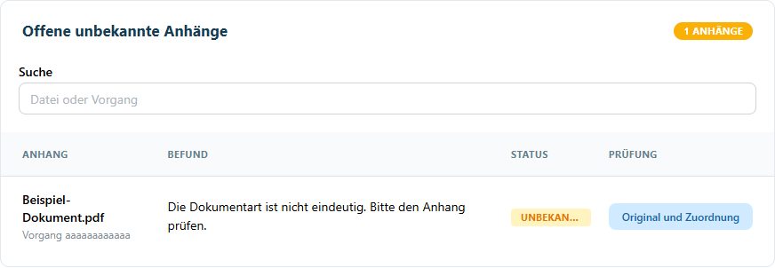

1. Öffnen Sie Unbekannt oder die gleichnamige Kachel der Übersicht.
2. Suchen Sie bei Bedarf nach Datei oder Vorgang. Weitere Filter wie in Vorgänge
   sind hier nicht vorhanden.
3. Wählen Sie **Original und Zuordnung**. Der betreffende Anhang wird direkt ausgewählt.
4. Lesen Sie Original und Befund vollständig, bevor Sie eine Kategorie entscheiden.
5. Ordnen Sie nur eine eindeutig begründete, angebotene Dokumentart zu; der genaue
   Freigabeablauf steht in Kapitel 9.

Die Meldung **Die Dokumentart ist nicht eindeutig. Bitte den Anhang prüfen.**
beschreibt eine gewöhnliche Unklarheit. **Struktur- oder Formatkonflikt** ist eine
andere Situation: Eine manuelle Zuordnung ist gesperrt und darf diesen Konflikt
nicht übergehen. Ebenso ist ein technischer Abruffehler keine fachliche Kategoriefrage.

Mit Leserechten können Sie das verfügbare Original und die Befunde lesen. Für die
Zuordnung benötigen Sie eine Person mit Verwaltungsrecht. Ist das Original nicht
prüfbar oder lässt es sich fachlich nicht eindeutig einordnen, geben Sie den Fall
an die Betreuung weiter. **Ignorieren** dient nicht dazu, einen unklaren wichtigen
Anhang aus der Liste verschwinden zu lassen.

Eine leere Ansicht besagt nur, dass zur Auswahl keine offenen unbekannten Anhänge
vorliegen. Sie bestätigt weder das Fehlen technischer Fehler noch die Vollständigkeit
des Postfachimports. Dafür auch Vorgänge und Betriebsstatus prüfen.

## 8. Original und PDF-Vorschau öffnen

Der Dialog zeigt links das verfügbare Original. PDF-Dateien erscheinen in der
PDF-Anzeige des Browsers. Rechts wechseln Sie zwischen den Anhängen; prüfen Sie
vor einer Entscheidung den Namen des tatsächlich ausgewählten Anhangs.

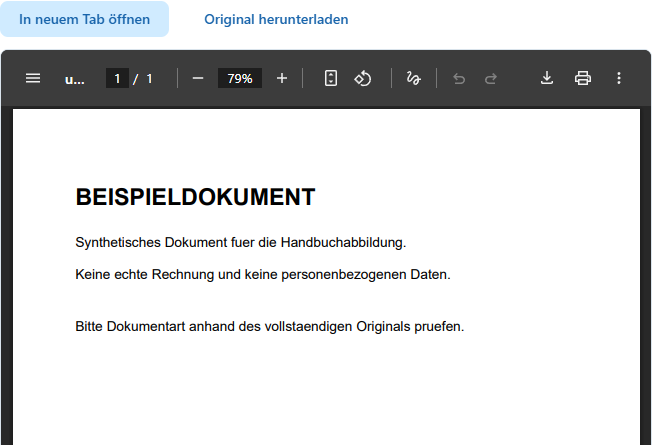

**In neuem Tab öffnen** zeigt dasselbe geprüfte Original in einem eigenen Tab.
**Original herunterladen** lädt genau dieses Original herunter. Andere Formate
werden als Originaldatei zum Herunterladen angeboten. Es gibt hier keinen Export
der gesamten Vorgangsliste oder aller Rechnungen. Die PDF-Werkzeugleiste selbst
stammt vom Browser; ihre Anordnung kann abweichen.

Nutzen Sie Zoom und Seitenwahl Ihres PDF-Betrachters für die vollständige Prüfung.
Eine erste Seite oder der Dateiname allein genügt nicht zur fachlichen Zuordnung.
Das Öffnen und Herunterladen geben keine Verarbeitung frei und verändern die Mail nicht.

Bei leerer Anzeige versuchen Sie den neuen Tab oder den Originaldownload. Bei
**Originalanzeige derzeit deaktiviert** entscheidet die Verwaltung über neue
Vorschauen. **Kein überprüfbares Original verfügbar** kann eine fehlende oder
veränderte Quelle bedeuten. Die Anwendung ersetzt diese nicht durch eine fremde Datei.
Bis zur Klärung keine ungesicherte Kategorie wählen.

Es sind höchstens zwei gleichzeitige Originalantworten bis je 25 MiB vorgesehen.
Schließen Sie nicht mehr benötigte Vorschauen und versuchen Sie einen belegten
Abruf später erneut. Eine anhaltende Störung mit Dateiname, Vorgangskennung und
Meldung an die Betreuung geben; keine privaten Dokumente unkontrolliert weiterleiten.

## 9. Eine Zuordnung freigeben

Voraussetzung: Verwaltungsrecht, zulässiger unbekannter Anhang und kein gesperrter
oder archivierter Zustand. Die Freigabe gilt **nur für diesen einzelnen Anhang**.

1. Prüfen Sie den ausgewählten Namen, Original und Befund.
2. Wählen Sie unter **Zuordnung** ausdrücklich PDF-Rechnung, Zahlungsavis,
   Mahnung / Zahlungserinnerung oder Ignorieren.
3. Wählen Sie **Zuordnung freigeben** genau einmal und warten Sie die Antwort ab.
4. Lesen Sie den Freigabestand und später den tatsächlichen Verarbeitungsstatus.

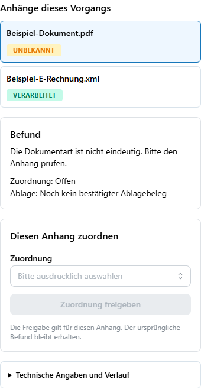

Die gespeicherte Zuordnung ist noch kein Ablageerfolg. Der Korrekturlauf hat alle
15 Minuten eine Gelegenheit. Bei Sperren, größeren Vorgängen oder Störungen kann
es länger dauern. Aktualisieren Sie später den Vorgang. Weitere offene Anhänge
müssen jeweils einzeln geklärt werden; eine Sammelfreigabe ist nicht vorhanden.

Der ursprüngliche Befund bleibt nachvollziehbar. Aus Ihrem Klick entsteht keine
automatische Lernregel für andere Rechnungen. Bei unbestätigter Antwort nicht
eine andere Kategorie oder eine neue Freigabe versuchen, sondern Kapitel 10 beachten.

## 10. Technische Wiederholung und unklare Antworten

Eine **Zuordnung** klärt die Dokumentart. Eine **technische Wiederholung** erlaubt
die erneute Bearbeitung eines dafür geeigneten technischen Problemfalls. Beides
sind verschiedene Entscheidungen. Ein Strukturkonflikt wird durch Wiederholung
nicht zu einer fachlich bestätigten Rechnung.

Für einen zulässigen technischen Fall:

1. Öffnen Sie den Vorgang und lesen Sie Befund, Fehler und vorhandene Belege.
2. Klären Sie die Ursache beziehungsweise lassen Sie sie von der Betreuung klären.
3. Wenn angeboten und fachlich abgestimmt, wählen Sie mit Verwaltungsrecht
   **Technische Wiederholung freigeben**.
4. Warten Sie auf die Bestätigung und den späteren Korrekturlauf. Der gespeicherte
   Wiederholungsauftrag und sein Stand erscheinen im Dialog.

Der Knopf erscheint nur, wenn der aktuelle Zustand es zulässt. Archivierte Fälle
sind schreibgeschützt. Deaktivierte neue Wiederholungen oder fehlende Rechte
nicht umgehen. Bereits freigegebene Aufträge bleiben bei einer späteren
Einstellungsänderung erhalten.

**Wenn eine Antwort verloren geht:** Der Dialog zeigt gegebenenfalls **Ausstehende
Bestätigung**. Ziel, Auswahl und ursprüngliche Anforderung bleiben erhalten.
Nutzen Sie **Ursprüngliche Anforderung abgleichen** für genau diese Absicht.
Ein Neuladen erzeugt keinen neuen Auftrag. Bleibt die Bestätigung unklar, Betreuung
hinzuziehen und die ursprüngliche Anforderung beibehalten; Browserdaten nicht als
vermeintliche Reparatur löschen.

Nur bei tatsächlich abgewiesener Anforderung kann **Abgewiesene Anforderung
schließen** angeboten werden. Das schließt den abgewiesenen Zustand in der
Oberfläche; es ist kein Rückgängigmachen einer Datei- oder Mailwirkung. Eine neue
Aktion erst nach erneuter sachlicher Prüfung ausdrücklich wählen.

Bei **Klärung erforderlich**, unklarer Ablage oder ungewisser Mailwirkung hilft
keine Klickserie. Die Betreuung muss bestehenden Beleg und tatsächliche Wirkung
abgleichen. Fügen Sie keine Kopie derselben Mail als Umgehung hinzu.

## 11. Dubletten richtig einordnen

Als Dublette gilt nach der vereinbarten Regel: **gleicher Originaldateiname und
gleiche Dateigröße in Bytes innerhalb der aktuellen Kalenderwoche**. Es wird
nicht gegen die gesamte Historie verglichen. Inhaltliche Gleichheit allein oder
ein ähnlicher Dateiname ist keine zusätzliche, zugesagte Dublettenregel.

1. Öffnen Sie die Kachel **Dubletten** oder setzen Sie in Vorgänge den Filter
   **Dubletten > Mit Dubletten**.
2. Öffnen Sie den Vorgang und wählen Sie den betroffenen Anhang.
3. Lesen Sie **Ablage: Dublette** und den Hinweis auf die bereits bestätigte Ablage.
4. Wenn die Einordnung fachlich zweifelhaft ist, Dateiname, Bytegröße und
   Vorgangskennung an die Betreuung geben. Keine erneute Ablage erzwingen.

Die Dublette wird nicht nochmals abgelegt. Andere neue relevante Anhänge
derselben Mail werden trotzdem passend abgelegt. Die Mail geht nach unzugeordnet,
solange kein höher priorisierter Fehler vorliegt. Eine Dublette ist daher nicht
mit einem vollständigen Abbruch aller Anhänge gleichzusetzen.

**Beispiel:** Zwei Mails enthalten in derselben Kalenderwoche jeweils
`Beispiel.pdf` mit derselben Bytegröße. Für den zweiten passenden Fall entsteht
ein Dublettenbeleg. Derselbe Name mit abweichender Größe ist ein anderer
Namenskonflikt; die Ablage verwendet einen Zusatz und überschreibt nichts.

Ein nachgelagertes System kann eine bereits abgelegte Datei entnehmen. Der
gespeicherte Beleg bleibt dennoch bestehen. Das Portal ist kein Dateimanager und
rekonstruiert solche Dateien nicht durch wiederholtes Freigeben. Pflege und
Übernahme im kundenseitigen DMS gehören nicht zur Bedienung dieses Importers.

## 12. Ältere Vorgänge im Archiv lesen

Das **Archiv** enthält ältere Verarbeitungsprotokolle. Sie bleiben zwei
Kalenderjahre ab der ersten Protokollanlage in der aktiven Ansicht und erscheinen
danach hier schreibgeschützt. Das ist keine pauschale Frist von genau 730 Tagen.

1. Öffnen Sie Archiv in der Hauptnavigation.
2. Verwenden Sie dieselben Such-, Status-, Kategorie-, Dubletten- und Eingangsfilter
   wie in Vorgänge. Bei vielen Treffern nutzen Sie die Seitenauswahl.
3. Öffnen Sie den gewünschten Vorgang über Ansehen.
4. Lesen Sie Befunde, vorhandene Belege und gegebenenfalls das noch verfügbare Original.

Archivierte Vorgänge sind auch für die Verwaltung schreibgeschützt. Eine
Zuordnung oder technische Wiederholung lässt sich dort nicht neu freigeben.
Bei erforderlicher historischer Klärung die Betreuung mit der Vorgangskennung ansprechen.

**Das Webarchiv ist keine Mailarchivierung.** Durch den Wechsel der Ansicht werden
weder Protokolle gelöscht noch Mails verschoben oder entfernt. Die weitere
Postfachpflege bleibt eine organisatorische Aufgabe beim Kunden. Auch die
Aufbewahrung von Dokumentdateien und die Datensicherung sind eigene Betriebsaufgaben.

Eine leere Archivansicht kann im jungen System normal sein. Die Meldung
**Keine archivierten Vorgänge für diese Auswahl** zuerst mit dem Suchbereich und
den Filtern abgleichen. Eine fehlgeschlagene Datenabfrage nicht als leeres Archiv werten.

## 13. Administration und Verarbeitungseinstellungen

Administration enthält vier Reiter: **Berichte**, **Benachrichtigungen**,
**Graph-Zertifikat** und **Verbindungen & Verarbeitung**. Beide Rollen dürfen
Informationen lesen. Änderungen bleiben der Verwaltung vorbehalten. Ein Wechsel
des Reiters ist keine Speicherung eines bearbeiteten Formulars.

Unter Verbindungen & Verarbeitung steht zunächst **Verarbeitung und Vorschau**.

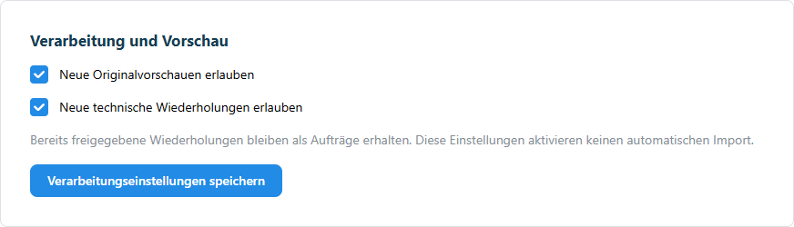

| Schalter | Wirkung |
| --- | --- |
| Neue Originalvorschauen erlauben | Erlaubt neue geprüfte Originalabrufe in der Vorschau. Kein Importstart und keine Mailänderung. |
| Neue technische Wiederholungen erlauben | Erlaubt die Erzeugung neuer zulässiger Wiederholungsaufträge. Bereits freigegebene Aufträge bleiben erhalten. |

1. Stimmen Sie die beabsichtigte Änderung ab und ändern Sie die passende Auswahl.
2. Wählen Sie **Verarbeitungseinstellungen speichern**.
3. Warten Sie auf **Einstellungen gespeichert** beziehungsweise lesen Sie eine Fehlermeldung.
4. Prüfen Sie den angezeigten Stand, bevor Sie eine davon abhängige Aktion beginnen.

Die beiden Schalter aktivieren keine automatische Verarbeitung. Eingang, Korrekturen
und Meldungen werden durch die eingerichteten Betriebszeitpläne ausgeführt. Deren
aktuellen Zustand sehen Sie in der Übersicht. Ein vermeintlich hängender Vorgang
wird nicht durch mehrfaches Umschalten sicher repariert.

Die Verbindungseinstellungen auf derselben Seite haben einen eigenen Aktivierungsweg
und eine größere Wirkung. Lesen Sie dafür Kapitel 20. Die verschiedenen Formulare
besitzen eigene Speicheraktionen; es gibt keinen einzigen globalen Speichernknopf.

## 14. Berichte anzeigen

Öffnen Sie **Administration > Berichte**. Die Ansicht verwendet gespeicherte
Journalwerte und steht beiden Rollen zur Verfügung. **Das Anzeigen versendet keine Mail.**

1. Wählen Sie unter **Berichtszeitraum** Tagesübersicht, Wochenübersicht (Mo-So)
   oder Zeitraum wählen.
2. Für einen Tag wählen Sie **Tag**. Für eine Woche genügt **Tag in der gewünschten
   Woche**; der Bericht umfasst Montag bis Sonntag dieser Woche.
3. Für einen freien Zeitraum verwenden Sie **Protokollanlage von** und
   **Protokollanlage bis einschließlich**. Höchstens 366 Tage sind je Abfrage möglich.
4. Wählen Sie **Bericht anzeigen**. Prüfen Sie den tatsächlich angezeigten Zeitraum
   und den Erstellstand, bevor Sie Zahlen weitergeben.

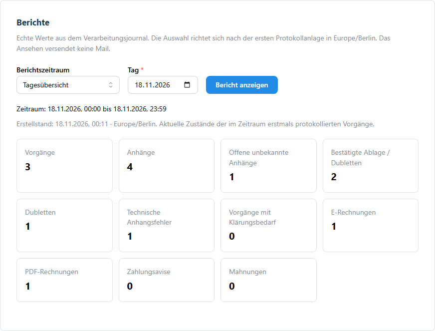

Die Zuordnung zum Zeitraum richtet sich nach der **ersten Protokollanlage** in
Europe/Berlin. Sie richtet sich nicht nach dem Mail-Eingangsfilter der Vorgangsliste
und nicht nach dem Zeitpunkt eines späteren Abschlusses. Die Zahlen zeigen den
aktuellen Stand dieser ausgewählten Vorgänge zum angegebenen Erstellstand.

Wählen Sie auch ältere Daten über den freien Zeitraum; ältere Protokolle bleiben
dadurch erreichbar. Eine Lademeldung oder ein Fehler ist keine Nullstatistik.
Die blaue Meldung **Keine Vorgänge in diesem Zeitraum** bezeichnet dagegen eine
erfolgreich geladene leere Auswahl. Das Portal bietet hier keinen zusätzlichen
Berichtsexport. Versendete Tages-/Wochenmails und die Berichtsansicht sind getrennte Wege.

## 15. Berichtszahlen richtig lesen

Ein Vorgang entspricht einer protokollierten Mail, ein Anhang einer ihrer Dateien.
Diese Einheiten dürfen nicht addiert oder gleichgesetzt werden. Eine Mail mit
zwei relevanten Anhängen kann einen Vorgang und zwei Anhänge ergeben.

| Kennzahl in Berichte | Bedeutung |
| --- | --- |
| Vorgänge | Im gewählten Zeitraum erstmals protokollierte Mailvorgänge. |
| Anhänge | Anhänge dieser ausgewählten Vorgänge. |
| Offene unbekannte Anhänge | Anhänge mit noch offener Zuordnung; keine Anzahl ganzer Mails. |
| Bestätigte Ablage / Dubletten | Anhänge mit bestätigtem Ablage- oder Dublettenbeleg. Enthält auch übersprungene Dubletten, keine Zahl ausschließlich neu geschriebener Dateien. |
| Dubletten | Anhänge mit dem protokollierten Dublettenstatus. Teil der passenden Ablage-/Dublettenbelege. |
| Technische Anhangsfehler | Anhänge mit technischem Verarbeitungs- oder Ablagefehler. |
| Vorgänge mit Klärungsbedarf | Vorgänge, deren Zustand Klärung erforderlich ist. Keine automatische Gleichsetzung mit allen einzelnen Anhangsfehlern. |
| E-Rechnungen, PDF-Rechnungen, Zahlungsavise, Mahnungen | Anhänge mit der jeweiligen gespeicherten Kategorie. Kategorie allein ist kein zusätzlicher Ablageerfolgsnachweis. |

**Beispiel:** Ein Vorgang wird Montag erstmals protokolliert und Dienstag geklärt.
Ein später angezeigter Montagsbericht kann den neuen aktuellen Zustand enthalten.
Er ist keine unveränderliche Momentaufnahme des Montagabends. Der Erstellstand
macht sichtbar, wann Sie die Auswertung geladen haben.

Ein versendeter Tagesbericht bezieht sich auf den vorhergehenden Berliner Tag.
Der Wochenbericht verwendet die vorhergehende abgeschlossene Montag-bis-Sonntag-
Woche und den eingestellten Versandtag. Vergleichen Sie stets den ausgewiesenen
Zeitraum und Stand, bevor Sie Mail und Portal nebeneinander beurteilen.

Die verschiedenen Zähler überlappen: Eine Dublette kann zugleich zu PDF und zu
Bestätigte Ablage / Dubletten gehören. Deshalb die Kacheln nicht als disjunkte
Teilmengen zu einer vermeintlichen Gesamtsumme addieren. Bei einer Differenz zuerst
Einheit, Zeitraum, aktive Filter und Erstellstand vergleichen.

## 16. Empfänger und Benachrichtigungspläne

Unter **Administration > Benachrichtigungen** sehen Sie zunächst den aktuellen
Meldungszeitplan und Informationen zum Graph-Anmeldezertifikat. Der Bereich
**Empfänger & Zeitpläne** zeigt den gespeicherten Einstellungsstand. Lesen darf
beide Rollen; Änderungen erfordern Verwaltung.

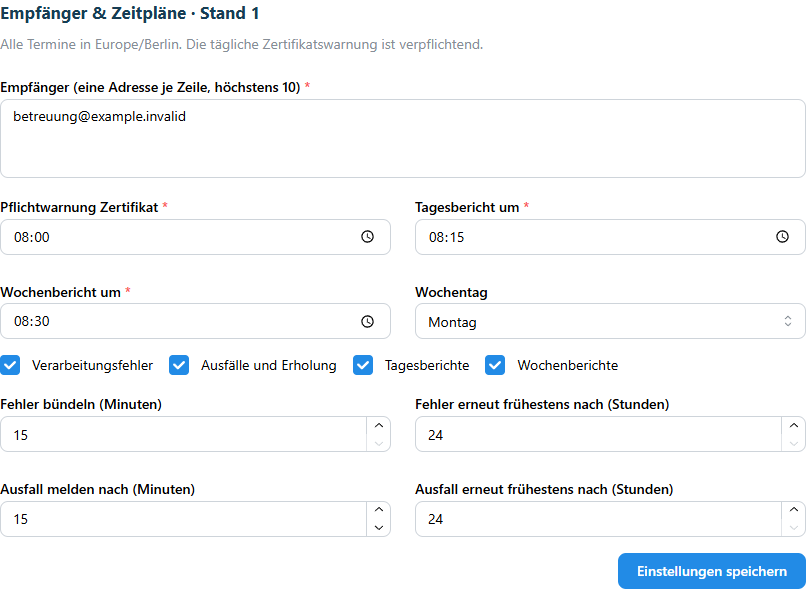

1. Tragen Sie je Zeile eine gültige, abgestimmte Empfängeradresse ein, höchstens zehn.
2. Wählen Sie die Uhrzeit der verpflichtenden Zertifikatswarnung, des Tagesberichts
   und des Wochenberichts sowie den Wochentag für den Wochenbericht.
3. Entscheiden Sie über Verarbeitungsfehler, Ausfälle und Erholung, Tagesberichte
   und Wochenberichte mit den entsprechenden Kontrollkästchen.
4. Stimmen Sie Bündel- und Wiederholungsabstände ab und wählen Sie **Einstellungen speichern**.

Alle Termine verwenden Europe/Berlin einschließlich Zeitumstellung. Die tägliche
Zertifikatswarnung ist verpflichtend und hat keinen Abschaltschalter. Änderungen
gelten erst nach erfolgreicher Speicherung, nicht bereits nach dem Tippen.

Fehler lassen sich 15 bis 1440 Minuten bündeln; erneute Fehlermeldungen frühestens
nach 24 bis 168 Stunden. Ein Ausfall wird nach 5 bis 1440 Minuten gemeldet;
erneute Ausfallmeldung frühestens nach 24 bis 168 Stunden. Dies sind Meldeabstände,
keine Importintervalle und keine zugesagte Reparaturfrist.

Gespeicherte Termine und tatsächlich laufende Zeitpläne sind getrennte Angaben.
Prüfen Sie zusätzlich Übersicht/Betriebsstatus. Die Automatik sendet keine Testmail.
Bei Graphausfall ist eine Warnmail über denselben ausgefallenen Weg nicht garantiert;
Portalhinweise und Betreuung bleiben erforderlich.

## 17. Testmail und Versandverlauf

Eine Testmail ist ein ausdrücklicher Versandauftrag der Verwaltung. Sie prüft
den festen vorgesehenen Text und die **gespeicherten** Empfänger. Es gibt keinen
freien Maileditor und keine zusätzliche manuelle Berichtssendefunktion.

1. Speichern und prüfen Sie zuvor die gewünschten Empfänger.
2. Wählen Sie **Vorschau der Testmail**. Dies bereitet eine feste Anforderung vor,
   zeigt Betreff, Text und Empfänger und versendet noch nichts.
3. Prüfen Sie die Vorschau. Erst **Einmal senden** löst den Versandversuch aus.
   Schließen der Vorschau allein sendet nicht.
4. Lesen Sie Ergebnis und Versandverlauf. Bei unbestätigter Antwort verwenden Sie
   **Ursprüngliche Anforderung abgleichen**, statt eine neue Testmail anzulegen.

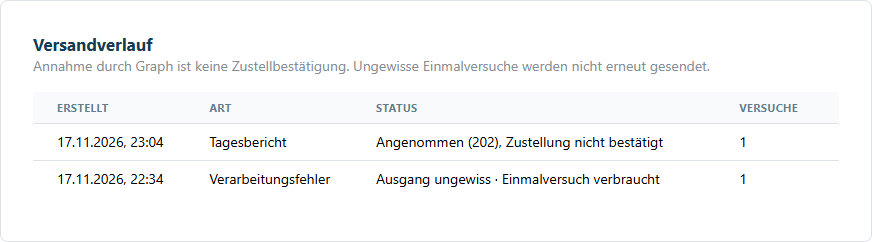

| Versandstatus | Bedeutung |
| --- | --- |
| Vorbereitet / wartet | Versandabsicht vorhanden, noch kein bestätigter Versandabschluss. |
| Versand läuft / Abgleich erforderlich | Versuch läuft oder muss abgeglichen werden. |
| Angenommen (202), Zustellung nicht bestätigt | Microsoft Graph hat angenommen. Empfang beim Empfänger ist damit nicht bewiesen. |
| Sicher abgewiesen | Dieser Versuch wurde sicher zurückgewiesen; Ursache prüfen. |
| Ausgang ungewiss - Einmalversuch verbraucht | Wirkung unklar; keine automatische erneute Sendung. Betreuung zum Abgleich hinzuziehen. |
| Überholt | Eine ältere Absicht ist nicht mehr die maßgebliche aktuelle Sendung. |

Der Verlauf zeigt Erstellt, Art, Status und Versuche; bei vielen Einträgen gibt es
eine Seitenauswahl. Eine abgeglichene abschließende Testanforderung kann über
**Abgeglichene Anforderung abschließen** geschlossen werden. Das löscht weder einen
Versandbeleg noch zieht es eine Mail zurück. Eine weitere Testmail ist ein neuer
bewusster Auftrag, kein Ersatz für den Abgleich einer unklaren Sendung.

## 18. Graph-Zertifikat und Warnungen

**Administration > Graph-Zertifikat** betrifft die Anmeldung des Importers am
Mailpostfach. Es ist ein anderes Zertifikat als das HTTPS-Zertifikat Ihres Browsers.
Eine gültige HTTPS-Seite bestätigt keine funktionierende Graph-Anmeldung und umgekehrt.

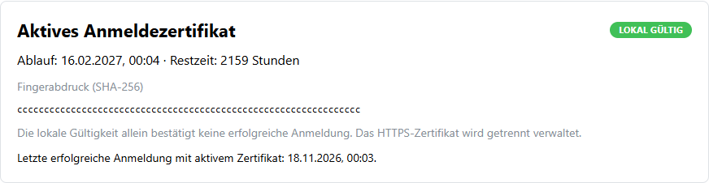

**Aktives Anmeldezertifikat** zeigt Ablauf, Restzeit, Fingerabdruck und lokale
Gültigkeit. Lesen Sie zusätzlich **Letzte erfolgreiche Anmeldung mit aktivem
Zertifikat**. Die Anzeige Lokal gültig allein ist kein frischer Anmeldenachweis.
Daneben stehen letzter Erneuerungsversuch, erfolgreiche Tagesprüfung und erfolgreiche
Erneuerung als getrennte Ereignisse. **Nicht bestätigt** heißt, dass der jeweilige
Nachweis fehlt, und nicht automatisch, dass der ganze Importer ausgefallen ist.

| Hinweis | Handlung |
| --- | --- |
| Grün / lokal gültig | Restzeit und erfolgreiche Anmeldung lesen; keine unnötige manuelle Erneuerung. |
| Orange, höchstens zehn Tage Restzeit | Graphwarnung beachten und Betreuung informieren. Eine offene gespeicherte Pflichtwarnung kann weiter sichtbar bleiben. |
| Rot, höchstens 24 Stunden oder abgelaufen | Betreuung innerhalb einer Stunde informieren; bei weniger als einer Stunde sofort. |
| Status nicht prüfbar | Status aktualisieren beziehungsweise Erneut prüfen. Bleibt der Nachweis offen, Betreuung informieren. |

Ein Warnhinweis erscheint gegebenenfalls nach Anmeldung für beide Rollen. **Hinweis
gelesen** schließt nur den Dialog; es behebt keinen Zertifikatsfehler. Eine gespeicherte
Pflichtwarnung endet erst mit einem passenden erfolgreichen Nachfolgernachweis,
nicht durch bloßen Dateitausch. Gelb bei einem Vorgang ist nicht dieselbe Aussage
wie Orange bei einem Zertifikat; lesen Sie immer den zugehörigen Text.

Bei einer Browserwarnung zum HTTPS-Zertifikat keine Sicherheitsausnahme als
Standardlösung einrichten. Portaladresse und Zeitpunkt an die Betreuung geben.
Beide Zertifikatswege werden technisch getrennt betreut.

## 19. Erneuerung erlauben und verfolgen

Die Verwaltung kann **Automatische Erneuerung erlauben** umschalten. Dieser
Schalter übermittelt die Änderung direkt; hier gibt es keinen zusätzlichen
Speichernknopf. Die gespeicherte Erlaubnis und tatsächlich bestätigte Betreiberzeitpläne
bleiben getrennte Voraussetzungen.

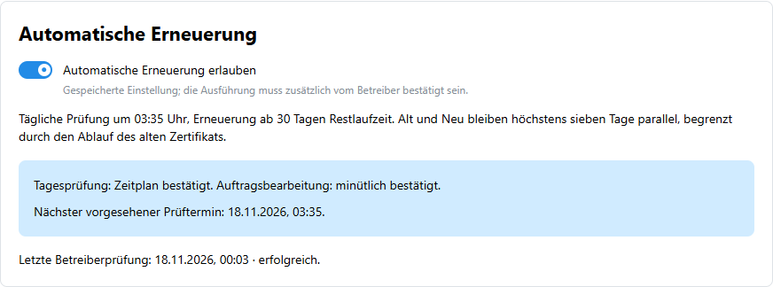

Die Tagesprüfung ist um 03:35 vorgesehen, die Auftragsbearbeitung minütlich.
Erneuerung beginnt im vorgesehenen Fenster ab 30 Tagen Restlaufzeit. Eine mehr
als zwei Stunden überfällige Tagesprüfung wird als Handlungsbedarf angezeigt.
Fristen sind in Europe/Berlin zu lesen.

Zwischenstände wie Anforderung wartet, Nachfolger vorbereitet/registriert/geprüft
oder Übernahme läuft sind noch kein Abschluss. Status lesen und abwarten;
bei ungewissem Ausgang Betreuung hinzuziehen.

**Jetzt erneuern** nur als abgestimmte Verwaltungsaktion verwenden:

1. Prüfen Sie Restzeit, aktuelle Hinweise und ob bereits eine Erneuerung offen ist.
2. Wählen Sie Jetzt erneuern einmal. Damit wird ein Auftrag gespeichert, noch kein Wechsel bestätigt.
3. Verfolgen Sie **Erneuerung & Überlappung**, **Verlauf** und Status aktualisieren.
4. Bei ungewisser Registrierung, Rückkehr oder Bereinigung ursprüngliche Anforderung
   erhalten und Betreuung hinzuziehen. Kein zusätzlicher Wechselauftrag als Umgehung.

**Nachfolger aktiv - Überlappung läuft** bestätigt den neuen Zugang; der Altstand
bleibt bis zur vorgesehenen Bereinigung, höchstens sieben Tage innerhalb seiner
Gültigkeit. Der Nutzer entfernt keine alten Schlüssel. **Mit altem Zertifikat
beendet** bedeutet kontrollierte Rückkehr, keine erfolgreiche Neuerneuerung.
Bei Hinweis offen bleibt Unterstützung erforderlich, auch wenn der Ablauf beendet ist.

Eine gespeicherte ursprüngliche Anforderung bleibt auch nach Neuanmeldung erhalten.
**Ursprüngliche Anforderung abgleichen** liest ihren Stand. **Erneut übermitteln**
wird nur für dieselbe noch nicht bestätigte Absicht angeboten, nicht als neuer Auftrag;
bei Unsicherheit Betreuung hinzuziehen. **Abgeglichene Anforderung schließen**
schließt einen abschließend abgeglichenen Vorgang in der Oberfläche. **Nicht angenommene,
überholte Anforderung verwerfen** erscheint nur nach entsprechendem Abgleich.
Diese Aktionen ersetzen keine technische Ursachenklärung und machen keinen Wechsel rückgängig.

## 20. Verbindungen und Änderungsprotokoll

Unter **Administration > Verbindungen & Verarbeitung** steht neben den
Verarbeitungsschaltern die **LDAP-Verbindung**. Diese Einstellungen betreffen
Firmenanmeldung und Gruppenrechte. Sie sind kein gewöhnlicher Schritt bei einer
unklaren Rechnung. Änderungen mit der zuständigen IT und Betreuung vorbereiten.

| Feld | Zweck |
| --- | --- |
| LDAPS-Server, einer je Zeile | Vereinbarte vollständige Servernamen des Verzeichnisdiensts; höchstens drei. |
| LDAPS-Port | Port des freigegebenen verschlüsselten Verzeichniszugangs. |
| Suchbasis (DN) | Verzeichnisbereich, in dem Konten gesucht werden. |
| Bindkonto (UPN oder DN) | Dienstkonto für Verzeichnisprüfungen, nicht Ihr persönliches Anmeldekennwort. |
| Bindkennwort ersetzen | Neues Dienstkennwort nur bei beabsichtigtem Ersatz eintragen. Bei hinterlegtem Kennwort leer lassen, um es zu behalten. |
| Verwaltungsgruppe / Lesegruppe | Direkte Gruppen-DNs, die die zwei Produktrollen festlegen. |
| Verbindungs-/Antwort-Timeout | Wartezeit der Verzeichnisverbindung, jeweils ein bis fünf Sekunden. |

Die Leserrolle sieht diese Werte schreibgeschützt. Geheimniswerte werden nicht
zurückangezeigt. CA und Schlüssel verwaltet der Betreiber außerhalb dieses Formulars.
Es gibt keine Nutzerverwaltung zum Anlegen lokaler Konten und keinen SSO-Schalter.

Für eine abgestimmte Änderung trägt die Verwaltung die geprüften Werte ein und
wählt **Prüfen und aktivieren**. Vor Aktivierung werden die Server, Gruppen und
fortbestehenden Verwaltungsrechte geprüft. Fehler erhalten den bisherigen aktiven
Stand. Erfolgreiche Aktivierung beendet bestehende Sitzungen; anschließend neu anmelden.
Bei einer widersprüchlichen Versionsmeldung aktuellen Stand neu lesen und abstimmen,
keine fremde Änderung blind überschreiben.

**Änderungs- und Zugriffsprotokoll** zeigt die letzten 100 Einträge mit Zeitpunkt,
Konto, Aktion, Ergebnis und Stand. Es enthält keine Kennwortinhalte. Bei einer
Rückfrage den passenden Zeitpunkt und Eintrag nennen. Die Ansicht hat keinen
zusätzlichen Export- oder Rücksetzknopf. Technische Wiederherstellung und
Operatorbefehle gehören in die technische Dokumentation und zur Betreuung.

## 21. Alltagssituationen entscheiden

| Situation | Sinnvoller nächster Schritt |
| --- | --- |
| Es gibt keine Mails ab dem 23.11.2026 und das Journal ist leer | Stichtag beachten. Aktive Zeitpläne und leerer Eingang können gleichzeitig korrekt sein. |
| Eine neue passende Mail erscheint noch nicht | Nächste Fünf-Minuten-Gelegenheit abwarten, Liste aktualisieren und Eingang/Filter prüfen. Bei fortbestehendem Problem Betriebsstatus und Betreuung. |
| Ein bekannter Anhang liegt neben Unbekannt | Jeden Anhang einzeln beurteilen. Erfolgreiche Geschwister nicht neu freigeben. |
| Eine PDF ist erkannt, Mail liegt in Nachfragen | Nachfragen ist das vereinbarte Mailziel gewöhnlicher Rechnungs-PDFs, kein zusätzlicher manueller Freigabeauftrag. |
| Zuordnung ist freigegeben, aber noch nicht verarbeitet | Korrekturen haben 15-Minuten-Gelegenheiten. Status lesen; bei Einschränkung oder anhaltendem Stillstand Betreuung. |
| Dublette bei gleichzeitig neuer Datei | Neue Datei kann abgelegt sein, Dublette wird übersprungen. Mailziel unzugeordnet kann korrekt sein. |
| Original fehlt oder Strukturkonflikt ist gesperrt | Keine Kategorie raten. Befund und Vorgangskennung zur Betreuung geben. |
| Nach Klick kam keine sichere Antwort | Vorhandene ursprüngliche Anforderung abgleichen. Keine neue Absicht, Mailkopie oder gelöschten Browserdaten als Umgehung. |
| Versand angenommen, Empfänger meldet nichts | Annahme 202 und Empfang unterscheiden. Mit Betreuung prüfen, keine zweite Mail allein wegen fehlenden Empfangs senden. |
| Zeitplan aktiv, aber letzte Ausführung fehlgeschlagen | Die getrennten Spalten beachten. Ergebnis und Uhrzeit melden; Grün allein bestätigt keine bestimmte Datei. |
| Eingang oder Korrekturen zurückgestellt | Beide teilen sich die Verarbeitung. Hinweis unter Letztes Ergebnis lesen und die nächste Gelegenheit abwarten. Eine vorgemerkte Aufgabe ist noch kein erfolgreicher Import. |
| Graphwarnung bleibt trotz lokal neuer Datei | Ein Dateitausch ist kein erfolgreicher Nachfolgernachweis. Betreuung mit Status und Zeitpunkt informieren. |

Bleibt ein Zustand unklar, ist der vorhandene Vorgang der Ausgangspunkt der
Klärung. Eine neue Mail, neue Freigabe oder neue Erneuerungsanforderung kann den
Abgleich erschweren. Lassen Sie die bereits gespeicherte Identität erhalten.
Die Betreuung entscheidet anhand der Belege über das gezielte weitere Vorgehen.

## 22. Häufige Fragen

### Muss ich jede erkannte Rechnung bestätigen?

Nein. Erkannte PDF-/E-Rechnungen, Zahlungsavise und Mahnungen laufen im vorgesehenen
Verarbeitungspfad. Eine ausdrückliche Dokumentartentscheidung ist für dafür
zulässige unbekannte Anhänge vorgesehen.

### Lernt die Software aus meiner Zuordnung?

Die Entscheidung gilt für diesen Anhang. Es gibt kein automatisches Selbsttraining
und keine sofortige globale Regeländerung. Wiederkehrende Muster können der
Betreuung als Beispiele für gesondert geprüfte Verbesserungen dienen.

### Warum unterscheiden sich Berichte und Vorgangsliste?

Berichte wählen nach erster Protokollanlage; die Eingangssuche verwendet den
Maileingang. Dazu kommen unterschiedliche Filter, Erstellstände und Einheiten.
Ein Anhang, eine Mail und ein Ablagebeleg sind verschiedene Dinge.

### Kann ich eine ganze Liste exportieren oder viele Anhänge auf einmal korrigieren?

Diese Funktionen sind nicht vorhanden. Die Zuordnung erfolgt einzeln je Anhang.
Der verfügbare Download betrifft das geprüfte Original im Dialog, keinen
zusätzlichen Gesamtexport der Vorgänge oder Berichte.

### Warum ist ein Knopf unsichtbar oder gesperrt?

Mögliche Gründe sind Leserechte, Archiv, deaktivierte neue Vorschauen/Wiederholungen,
unzulässiger Befund, laufende Aktion oder eine noch ungeklärte ursprüngliche
Anforderung. Den angezeigten Hinweis lesen und die Ursache klären statt Rechte zu umgehen.

### Reicht eine grüne Statusanzeige als vollständige Kontrolle?

Sie bestätigt den jeweiligen frischen Nachweis, keine Vollprüfung aller Dokumente,
Mailzustellung oder Sicherung. Der konkrete Vorgang und seine Belege bleiben maßgeblich.

### Sind Mails im Webarchiv automatisch langfristig aufbewahrt?

Das Webarchiv ist eine schreibgeschützte Protokollansicht. Mailpflege, Datei-
aufbewahrung, Datensicherung und DMSbetrieb sind gesondert organisiert.

### Kann eine Graph-Ausfallwarnung immer noch per Mail ankommen?

Nein. Warnungen verwenden die vorhandene Graph-Anbindung. Ist diese nicht nutzbar,
ist der Warnempfang nicht garantiert. Portal und unabhängige Betreuungskontrolle beachten.

## 23. Begriffe nachschlagen

| Begriff | Erklärung |
| --- | --- |
| Vorgang | Gespeicherter Verarbeitungsablauf einer Mail mit ihren Anhängen. |
| Anhang | Einzelne Originaldatei einer Mail; kann einen eigenen Befund und Status haben. |
| Befund | Ergebnis der Erkennung beziehungsweise Prüfung, einschließlich Grund. |
| Kategorie | Dokumentart und zugehöriger Ablagebereich, etwa PDF oder Zahlungsavis. |
| Mailziel | Vereinbarter Postfachordner für die gesamte Mail nach Gesamtpriorität. |
| Freigabe | Gespeicherte ausdrückliche Entscheidung; noch kein bestätigter Ausführungserfolg. |
| Technische Wiederholung | Zulässiger Auftrag, einen technischen Problemfall gezielt erneut zu bearbeiten. |
| Ablagebeleg | Gespeicherte Bestätigung einer Ablage oder Dublette, nicht bloß ein Dateiname. |
| Dublette | Regelgebundener Fall gleicher Originalname/Bytegröße innerhalb aktueller KW. |
| Erstbefund | Ursprüngliche Entscheidung, die trotz späterer Klärung nachvollziehbar bleibt. |
| Protokollanlage | Erstmalige Erfassung im Journal; bestimmt die Berichtsauswahl. |
| Erstellstand | Zeitpunkt, zu dem eine Auswertung mit den aktuellen Zuständen erstellt wurde. |
| Zeitplan | Startgelegenheiten für einen Ablauf; keine Zusage einer fertigen Verarbeitung zu dieser Sekunde. |
| Ungewiss | Eine äußere Wirkung ist nicht sicher bestätigt oder ausgeschlossen; Abgleich erforderlich. |
| Graph | Microsoft-Schnittstelle für den vereinbarten Postfachzugriff und Mailversand. |
| HTTPS | Geschützte Browserverbindung zum Portal, mit eigenem Zertifikat. |
| Fingerabdruck | Kennzeichnung eines bestimmten Zertifikats oder Dateiinhalts; kein Kennwort. |
| Überlappung | Begrenzte Zeit, in der altes und neues Graph-Zertifikat nebeneinander bestehen. |
| AD / UPN | Firmenverzeichnis beziehungsweise übliche eindeutige Anmeldeschreibweise eines Firmenkontos. |
| KW / Europe/Berlin | Kalenderwoche beziehungsweise verwendete Berliner Zeitzone mit Zeitumstellung. |

Die Fachbegriffe dienen der Einordnung. Für alltägliche Entscheidungen zuerst
verständlichen Meldungstext, ausgewählten Anhang und bestätigten Ergebnisstand lesen.
Eine technische Kennung allein ist keine Handlungsempfehlung.

## 24. Betreuung, Grenzen und weitere Unterlagen

Bei fachlicher Unsicherheit zunächst die zuständige Verwaltung ansprechen. Bei
technischen Fehlern, unklarer Wirkung, Warnungen oder Zugriffsproblemen den
vereinbarten Supportweg zur Betreuung nutzen. Tatsächliche Ansprechpartner und
Kontaktwege werden separat vertraulich übergeben.

Hilfreich für eine Rückfrage sind:

1. Datum und Uhrzeit, verwendete Seite und genaue Meldung.
2. Vorgangskennung und betroffener Anhangsname; falls vorhanden der neutrale Fehlercode.
3. Was Sie unmittelbar zuvor gewählt haben und ob eine ursprüngliche Anforderung offen ist.
4. Der sichtbare Zustand von Vorgang, Betriebsstatus oder Versandverlauf und dessen Zeitpunkt.

Keine Kennwörter, privaten Schlüssel oder vollständigen vertraulichen Rechnungen
über ungesicherte Wege senden. Screenshots nur mit dem erforderlichen Ausschnitt
und nach den internen Datenschutzregeln weitergeben. Löschen oder verändern Sie
keine Journale, Mails oder Browserdaten zur vermeintlichen Fehlerbeseitigung.

Die Anleitung beschreibt die vorhandenen Möglichkeiten. Sie fügt keine Lernfunktion,
Sammelkorrektur, Exportfunktion, DMSintegration oder zusätzliche Erkennungsgarantie hinzu.
Tages- und Wochenberichte werden seit dem 24.11.2026 im Portalstil erzeugt;
die erste reguläre Outlook-Abnahme bleibt offen. Die wöchentliche Linuxwartung
ist eingerichtet. Der [Wartungsnachtrag](WARTUNGSNACHTRAG.md) erklärt Termin,
Portalunterbrechung und Nachkontrolle. Diese Abläufe benötigen keine zusätzlichen
Nutzerknöpfe.

Historische Prüfungen und aktueller Betrieb sind getrennt dokumentiert. Es gibt
eine historische echte AD-Kundenabnahme sowie isolierte Oberflächenprüfungen;
die synthetischen Handbuchbilder behaupten keine neue echte Kundenanmeldung.
Die verwaltete Altkeybereinigung wurde am 24.11. bestätigt. Der künftige reguläre
Erneuerungsauslöser, vollständige VM-/Offsite-Restore, vollständige Sonntagswartung
und fachliche Erkennungsrestfälle bleiben im
jeweils dokumentierten Umfang offen. Das Handbuch erklärt die Bedienung und
erteilt keine neue Betriebs- oder Gesamtfreigabe.

Technische Administration, Sicherung, Wiederherstellung und Operatorbefehle stehen
in der [technischen Dokumentation](TECHNISCHE-DOKUMENTATION.md) beziehungsweise
deren [PDF](handbuecher/Technische-Dokumentation.pdf). Den festen Produkt- und
Dokumentstatus finden Sie in [README](../README.md) und
[Dokumentübergabe](AP09-UEBERGABE.md). Es wird dieses eine führende Nutzerhandbuch
gepflegt; die technische Dokumentation ergänzt es für den Betrieb.
